# Codebox - ワンクリックでコードをコピー/記事をダウンロード

[中文](README.md) | [English](README_EN.md) | 日本語

## 公式サイト

https://www.code-box.fun/

## はじめに

このブラウザ拡張機能は、CSDN/知乎/脚本之家/博客园/51CTO博客/php中文网/掘金/WeChat などのウェブサイトで使用できます。ワンクリックで記事を HTML または Markdown ファイルとしてダウンロードしたり、ログインせずにコードをコピーしたりできます。コードの選択に対応し、コード右上のボタンからワンクリックでコードをコピーすることもできます。また、「ブロガーをフォローすると全文を読めます」という案内を解除し、ログインのポップアップや APP へ遷移させるポップアップを非表示にします。

さらに **記事の同期** にも対応しています。現在の記事をワンクリックで 29 以上の主要プラットフォーム（WeChat、知乎、微博、小紅書、掘金、CSDN、今日頭条など）に同期でき、デフォルトでは下書きとして保存されます。WordPress や Typecho などの自前ホスティングのブログにも対応しています。

## インストール

### インストール方法 1: 拡張機能ストア（推奨）

直接ダウンロードしてインストールします:
1. アプリストアを開きます
    - [Chrome ウェブストア](https://chrome.google.com/webstore/category/extensions?hl=zh-CN)
    - [Edge ウェブストア](https://microsoftedge.microsoft.com/addons/Microsoft-Edge-Extensions-Home?hl=zh-CN)
    - [360 ブラウザ アプリストア](https://ext.se.360.cn/#/extension-detail?id=acnnhjllgegbndgknlliobjlekgilbdf)
    - [Firefox ウェブストア](https://addons.mozilla.org/zh-CN/firefox/)

2. 検索: `codebox`

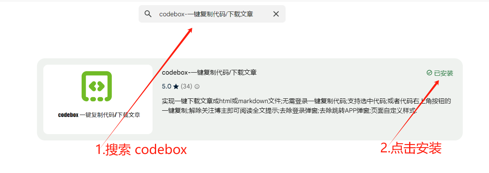
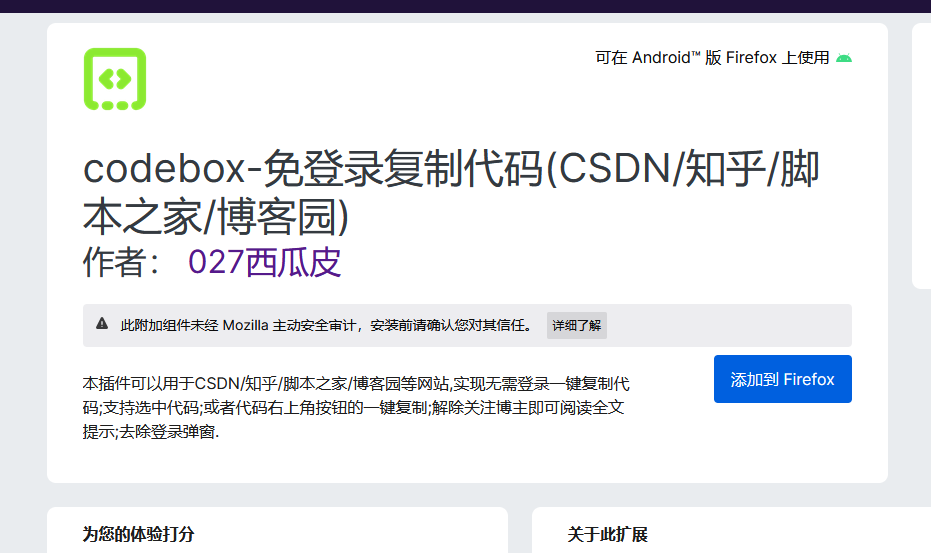
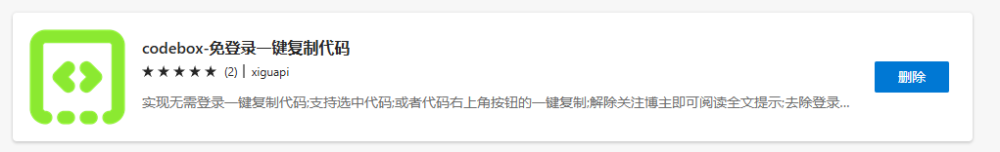

### インストール方法 2: 直接インストール

1. インストール先:
    - [Chrome 拡張機能ストアへ](https://chrome.google.com/webstore/detail/acnnhjllgegbndgknlliobjlekgilbdf)
    - [360 ブラウザ 拡張機能ストアへ](https://ext.se.360.cn/#/extension-detail?id=acnnhjllgegbndgknlliobjlekgilbdf)
    - [Firefox 拡張機能ストアへ](https://addons.mozilla.org/zh-CN/firefox/addon/code-box/)
    - [Edge 拡張機能ストアへ](https://microsoftedge.microsoft.com/addons/detail/code-box/cfpdbfmncaampihkmejogihjkenkonbn)

### インストール方法 3: WeChat 公式アカウントからダウンロード

1. WeChat 公式アカウントをフォローします


2. `Software Download` をクリックします

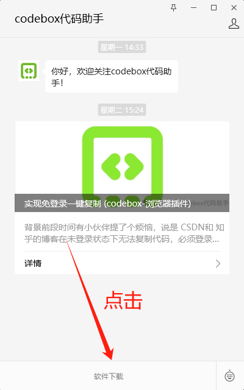

### インストール方法 4: ソースコードからインストール

1. ソースコードをクローンします
   ```sh
   git clone https://github.com/027xiguapi/code-box.git
   ```
2. インストールしてパッケージ化します
   ```sh
   pnpm install
   pnpm dev
   pnpm build
   ```
3. Google Chrome の場合、右上のメニュー -> その他のツール -> 拡張機能 から拡張機能の管理ページを開くか、アドレスバーに直接 chrome://extensions と入力してアクセスします。
4. デベロッパー モードをオンにすると、フォルダ形式で拡張機能を直接読み込めます。

## 機能

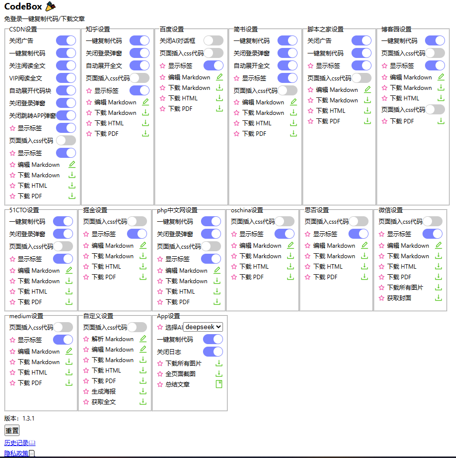

### 記事の同期（29 以上のプラットフォーム） 🆕

[Wechatsync](https://github.com/wechatsync/Wechatsync) のアダプターアーキテクチャを移植したものです。ワンクリックで現在の記事を **29 以上の主要プラットフォーム** に同期し、デフォルトでは下書きとして保存します。

#### 特長

- **自分のセッションを使用**: ブラウザに既にある Cookie を読み取るため、追加の認可もパスワードも不要です
- **公式のウェブ API を呼び出し**: 各プラットフォームのエディター自体が使用するのとまったく同じエンドポイントを使います
- **データはブラウザの外に出ません**: すべてのリクエストはブラウザからプラットフォームへ直接送信され、中継サーバーはありません
- **下書き優先**: 記事はデフォルトで下書きとして保存され、自動的に公開されることはありません
- **画像の自動転送**: 記事内の画像は同期先のプラットフォームに再アップロードされます
- **プラットフォームごとのコンテンツ調整**: プラットフォームによって受け付ける HTML が異なる（リンクを残すか削除するか、空白の詰め方、コードブロックの形式など）ため、同期先ごとにコンテンツを個別に前処理します
- **自前ホスティングのブログ**: WordPress、Typecho、MetaWeblog

#### 使い方

1. 任意の記事ページ（WeChat、知乎、掘金、CSDN、博客园など）を開きます
2. 次のいずれかの入口から同期パネルを開きます:
   - 拡張機能アイコンをクリック → `記事を同期`
   - 記事ページのフローティングパネル → `文章同步` / `Sync Articles`
   - WeChat 記事ページのパネル → `文章同步`
3. 抽出された記事を確認し、同期先のプラットフォームを選択して（パネルには各プラットフォームのログイン状態が表示されます）、`开始同步`（同期を開始）をクリックします
4. パネルにはプラットフォームごとのステータスと下書きへのリンクが表示され、同期履歴も保存されます

#### 対応プラットフォーム

| プラットフォーム | ID | 種類 | 同期方式 |
|-----|-----|-----|-----|
| WeChat 公式アカウント | weixin | 主要メディア | API（下書き） |
| 知乎 | zhihu | 主要メディア | API（下書き） |
| 微博 | weibo | 主要メディア | API（下書き） |
| 小紅書 | xiaohongshu | 主要メディア | エディター補助（ベータ） |
| 掘金 | juejin | 技術コミュニティ | API（下書き） |
| CSDN | csdn | 技術コミュニティ | API（下書き） |
| 簡書 | jianshu | 一般 | API（下書き） |
| 今日頭条 | toutiao | 一般 | API（下書き） |
| 抖音（画像とテキスト） | douyin | 主要メディア | エディター補助（ベータ） |
| bilibili コラム | bilibili | 一般 | API（下書き） |
| 百家号 | baijiahao | 一般 | API（下書き） |
| 語雀 | yuque | 技術コミュニティ | API（下書き） |
| 豆瓣 | douban | 一般 | API（下書き） |
| 捜狐 | sohu | 一般 | API（下書き） |
| 雪球 | xueqiu | 金融 | API（下書き） |
| 人人都是产品经理 | woshipm | プロダクト | API（下書き） |
| 大魚号 | dayu | 一般 | API（下書き） |
| 一点資訊 | yidian | 一般 | API（下書き） |
| 51CTO | 51cto | 技術コミュニティ | API（下書き） |
| 慕課網 | imooc | 技術コミュニティ | API（下書き） |
| OSChina | oschina | 技術コミュニティ | API（下書き） |
| SegmentFault | segmentfault | 技術コミュニティ | API（下書き） |
| 博客园 | cnblogs | 技術コミュニティ | API（下書き） |
| 捜狐焦点 | sohufocus | 不動産 | API（下書き） |
| X (Twitter) | x | 海外 | エディター補助（ベータ） |
| 東方財富 | eastmoney | 金融 | API（下書き） |
| 什么值得买 | smzdm | 一般 | エディター補助（ベータ） |
| 網易 | netease | 一般 | エディター補助（ベータ） |
| WordPress | wordpress | CMS | API（下書き） |
| Typecho | typecho | CMS | API（下書き） |
| Hexo | zip-download | CMS | Markdown パッケージのダウンロード |
| Hugo | zip-download | CMS | Markdown パッケージのダウンロード |

> 注: 「エディター補助」とは、プラットフォームが公開の下書き API を提供していない（または API にブラウザ側での署名やリスク管理チェックが必要な）ことを意味します。拡張機能がプラットフォームの公式エディターを開いてタイトルと本文をあらかじめ入力するので、内容を確認したうえで下書きを保存するか公開してください。

#### 自前ホスティングのブログ（WordPress / Typecho / MetaWeblog）

同期パネルの「自前ホスティングのアカウント」で、サイトの URL、ユーザー名、パスワードを入力します（パスワードはローカルのブラウザにのみ保存されます）。WordPress ユーザーはアプリケーションパスワードを使用してください。

#### コード構成（開発者向け）

```
sync/
├── types.ts                  # shared types (Article / SyncResult / PlatformMeta)
├── lib/                      # HTML→Markdown, image parsing, CSS inlining, AWS4 signing, logger
├── runtime/                  # runtime abstraction + Chrome extension implementation
├── adapters/
│   ├── code-adapter.ts       # adapter base class (requests, image upload, header rules)
│   ├── editor-assist.ts      # editor-assist base class (semi-automatic sync)
│   ├── registry.ts           # adapter registry
│   ├── platforms/            # 29 platform adapters
│   └── cms/                  # WordPress / MetaWeblog (Typecho)
└── extension/                # article extractor, per-platform preprocessing, sync engine
contents/sync.ts              # content script: extraction + preprocessing
tabs/sync.tsx                 # the sync panel UI
```

プラットフォームを追加するには、`sync/adapters/platforms/` に `CodeAdapter` のサブクラスを実装し（プラットフォームがブラウザのエディターを必要とする場合は `EditorAssistAdapter` を継承します）、`sync/adapters/platforms/index.ts` の `ALL_ADAPTERS` に登録します。


### カスタマイズ

- カスタムスタイル（CSS コード）を挿入
- すべての画像をダウンロード
- 選択範囲をカスタマイズして HTML をダウンロード
- 選択範囲をカスタマイズして Markdown をダウンロード
- 選択範囲をカスタマイズして PDF をダウンロード

### WeChat

- カスタムスタイル（CSS コード）を挿入
- 記事の HTML をワンクリックでダウンロード
- 記事の Markdown をワンクリックでダウンロード
- 記事の PDF をワンクリックでダウンロード
- すべての画像をワンクリックでダウンロード
- 画像投稿（图文）をワンクリックでダウンロード: 元画像を zip で、Markdown + 画像を zip で保存できます。`mp.weixin.qq.com/s/xxx` と `mp.weixin.qq.com/s?__biz=...` の両方のリンク形式に対応しています

### 小紅書

- ノート詳細ページの右下に「ノートをダウンロード」ボタンを表示
- ノートの画像とタイトル/本文を zip（Markdown + 画像）としてダウンロード
- カルーセル（swiper）のスライドの重複を除き、画像に元の順序どおりに番号を付けます

### ChatGPT

- 会話ページの右下に「Markdown をダウンロード」と「画像を保存」ボタンを表示
- Markdown のエクスポートでは会話全体をスクロールして読み込み（仮想化されたリストにも対応）、ユーザー/アシスタントのメッセージ、コードブロック、表、画像リンクを保持します
- 会話内のすべての画像を `chatgpt/<conversation title>/` フォルダに保存します

### 掘金

- カスタムスタイル（CSS コード）を挿入
- 記事の HTML をワンクリックでダウンロード
- 記事の Markdown をワンクリックでダウンロード
- 記事の PDF をワンクリックでダウンロード

### CSDN

- 記事の HTML、PDF、Markdown ファイルをワンクリックでダウンロード
- 任意の `CSDN` ブログを開くだけでコードをコピー可能
- `CSDN` にログインしていなくてもコードの選択に対応
- `CSDN` にログインしていなくても、コード右上のボタンからワンクリックでコードをコピー
- `CSDN` にログインしていなくても、ログインを強制するポップアップを表示しない
- ブロガーをフォローしていなくても「ブロガーをフォローすると全文を読めます」という案内を表示せず、全文を表示
- コードブロックを自動的に展開
- モバイルでの APP へのリダイレクトをブロック
- VIP 以外のユーザーにも VIP 閲覧の案内を表示せず、全文を表示
- カスタムスタイル（CSS コード）を挿入

### 知乎

- 記事の HTML、PDF、Markdown ファイルをワンクリックでダウンロード
- コードをワンクリックでコピー
- `Zhihu` にログインしていなくても「展開して全文を読む」という案内を表示せず、全文を表示
- `Zhihu` にログインしていなくても、ログインを強制するポップアップを表示しない
- カスタムスタイル（CSS コード）を挿入

### 百度

- 対話ボックスの HTML、PDF、Markdown ファイルをワンクリックでダウンロード
- AI 対話ボックスを閉じる

### 簡書

- 記事の HTML、PDF、Markdown ファイルをワンクリックでダウンロード
- モバイルでコードをワンクリックでコピー
- 「展開して全文を読む」という案内を表示せず、全文を表示
- ログインを強制するポップアップを表示しない
- カスタムスタイル（CSS コード）を挿入

### 脚本之家

- 記事の HTML、PDF、Markdown ファイルをワンクリックでダウンロード
- 任意の `Script Home` ブログを開くだけでコードをコピー可能
- `Script Home` にログインしていなくてもコードの選択に対応
- 広告をブロック
- `Script Home` にログインしていなくても、モバイルでコード右上のボタンからワンクリックでコードをコピー
- カスタムスタイル（CSS コード）を挿入

### 博客园

- 記事の HTML、PDF、Markdown ファイルをワンクリックでダウンロード
- コードをワンクリックでコピー
- カスタムスタイル（CSS コード）を挿入

### 51CTO博客

- 記事の HTML、PDF、Markdown ファイルをワンクリックでダウンロード
- `51CTO Blog` にログインしていなくてもコードの選択に対応
- `51CTO Blog` にログインしていなくても、コード右上のボタンからワンクリックでコードをコピー
- `51CTO Blog` にログインしていなくても、ログインを強制するポップアップを表示しない
- `51CTO Blog` にログインしていなくても、モバイルでコード右上のボタンからワンクリックでコードをコピー
- カスタムスタイル（CSS コード）を挿入

### php中文网

- 記事の HTML、PDF、Markdown ファイルをワンクリックでダウンロード
- `PHP Chinese Network` にログインしていなくてもコードの選択に対応
- `PHP Chinese Network` にログインしていなくても、コード右上のボタンからワンクリックでコードをコピー
- `PHP Chinese Network` にログインしていなくても、ログインを強制するポップアップを表示しない
- `PHP Chinese Network` にログインしていなくても、モバイルでコード右上のボタンからワンクリックでコードをコピー
- カスタムスタイル（CSS コード）を挿入

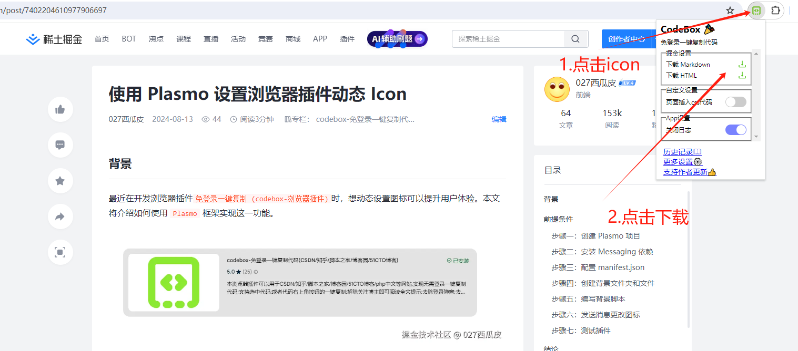
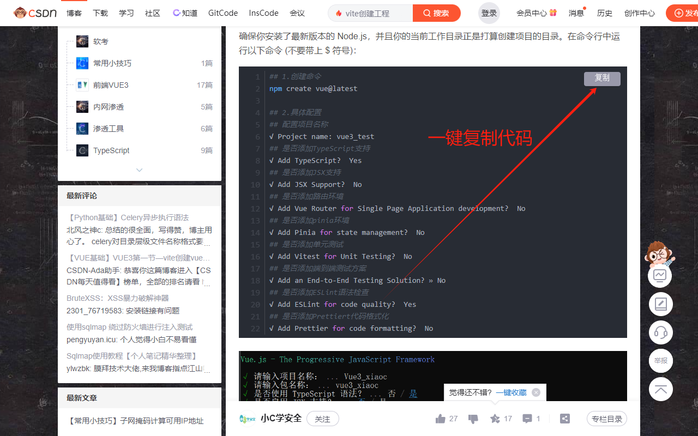
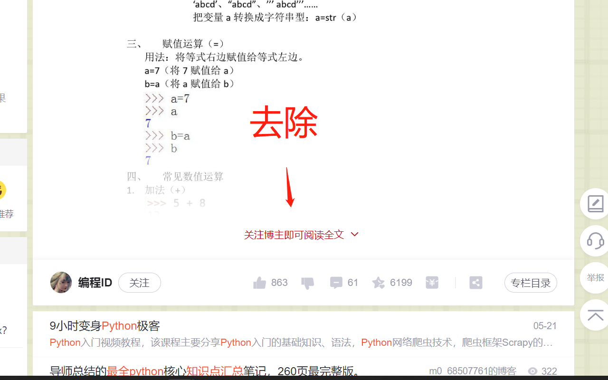
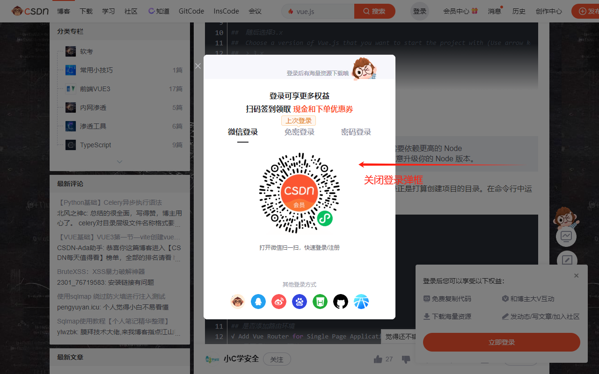
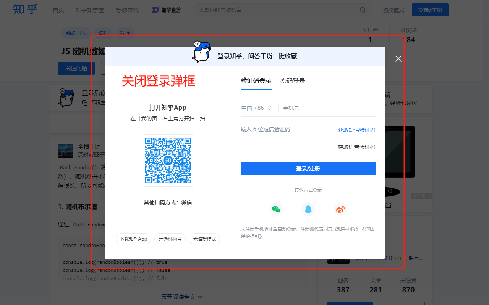
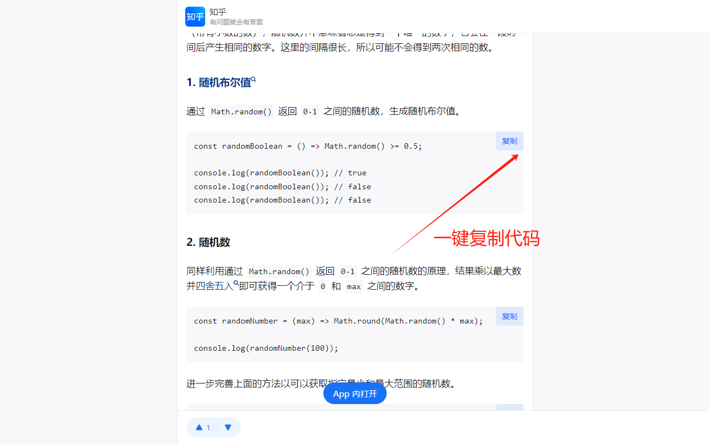
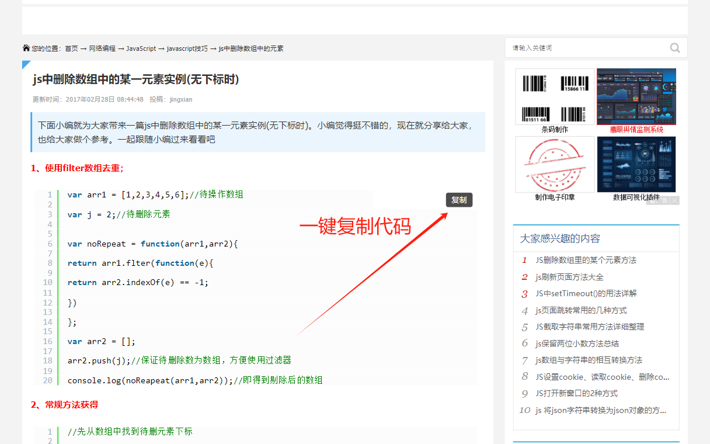
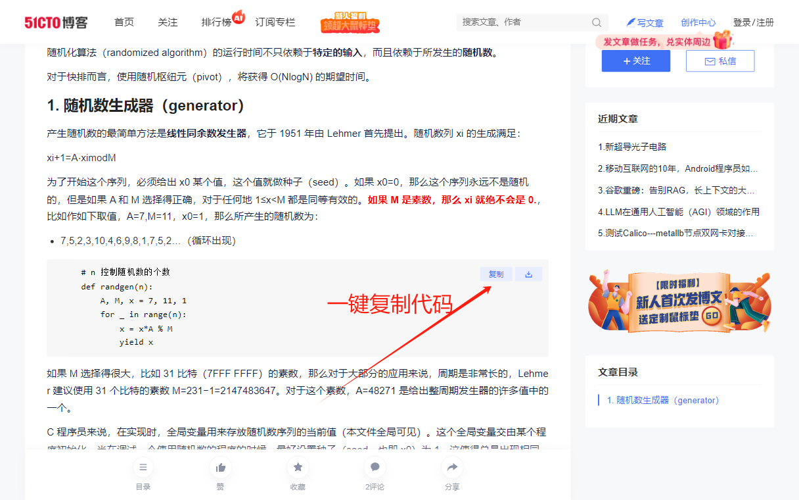
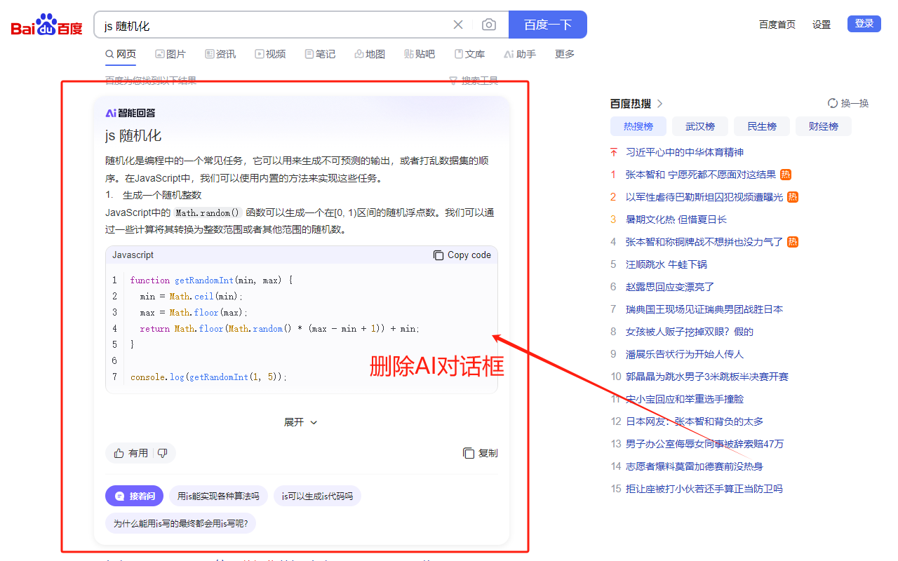

## 参考

1. [copy-csdn](https://github.com/openHacking/copy-csdn)
2. [plasmo](https://github.com/PlasmoHQ/plasmo)
3. [Chrome ウェブストア ワンストップサポート](https://support.google.com/chrome_webstore/contact/one_stop_support)
4. [すぐに使えるウェブページの印刷とダウンロード](https://juejin.cn/post/7412672713376497727)
5. [WeChat 公式アカウントの記事を PDF にエクスポート](https://greasyfork.org/en/scripts/510683-%E5%AF%BC%E5%87%BA%E5%BE%AE%E4%BF%A1%E5%85%AC%E4%BC%97%E5%8F%B7%E6%96%87%E7%AB%A0%E4%B8%BApdf/code)
6. [WeChat 公式アカウントの記事画像をワンクリックでダウンロード](https://greasyfork.org/zh-CN/scripts/40583-%E5%BE%AE%E4%BF%A1%E5%85%AC%E4%BC%97%E5%8F%B7%E6%8E%A8%E6%96%87%E5%9B%BE%E7%89%87%E4%B8%80%E9%94%AE%E4%B8%8B%E8%BD%BD/code)
7. [Wechatsync](https://github.com/wechatsync/Wechatsync)（記事同期のアダプターシステムの参考）

## プライバシーポリシー

[ウェブページ](https://027xiguapi.github.io/code-box/privacy-policy.html)

## リンク

- https://www.metrolinehub.com
- https://routerpark.com
- http://aitubestats.com
